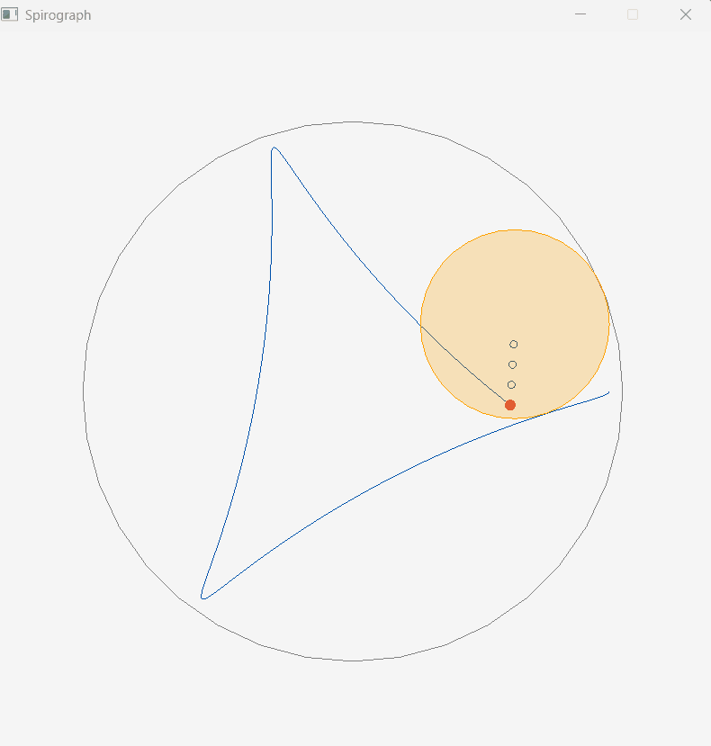

# WilliamMidterm 2D Game Project

<div align="center">
  
  <p><em>Gameplay demonstration</em></p>
</div>

---

## Overview

**WilliamMidterm** is a 2D game project developed in **C++20** using the **Raylib** library for graphics, window management, and input handling.

The project is built using **Premake5**, which generates Visual Studio solution and project files. It follows a modular directory structure that separates game source code, header files, external dependencies, and compiled binaries.

The main goal of this repository is to provide a structured environment for developing, building, debugging, and extending a 2D game application.

## Technologies

| Technology | Description |
|---|---|
| C++20 | Primary programming language |
| Raylib | Graphics and game development framework |
| Premake5 | Build system and project generation |
| Visual Studio 2022 | IDE and debugger |
| Git | Version control |
| Windows x64 | Target development platform |

## Project Structure

```text
Midterm_2D/
│
├── assets/
│   └── gameplay.gif
│
├── Binaries/
│   ├── Intermediates/
│   │   └── windows-x86_64/
│   │       ├── Debug/
│   │       └── Release/
│   │
│   └── windows-x86_64/
│       ├── Debug/
│       │   ├── Game/
│       │   └── Raylib/
│       └── Release/
│           ├── Game/
│           └── Raylib/
│
├── build/
│
├── Game/
│   ├── include/
│   └── src/
│
├── Vendor/
│   └── raylib/
│       ├── Build-raylib.lua
│       └── src/
│           ├── external/
│           │   ├── glfw/
│           │   └── RGFW/
│           └── platforms/
│
├── build.lua
├── .gitignore
└── README.md
```

*This structure includes planned and generated directories. The `assets` folder is intended for the gameplay GIF.*

### Directory Descriptions

**Game/src/**

Contains the `.cpp` files implementing the game's functionality. This is where the main game logic and any additional gameplay systems are developed.

**Game/include/**

Contains the `.h` header files used for declarations, structures, classes, and shared functionality.

**Vendor/raylib/**

Contains the Raylib dependency, including its source code and platform-specific dependencies.

**Binaries/**

Stores compiled executable files and intermediate build artifacts. The output is separated by operating system, architecture, build configuration, and project.

**build/**

Stores Visual Studio solution and project files generated by Premake.

**build.lua**

Contains the Premake configuration used to define the workspace, project settings, source files, dependencies, and output directories.

**assets/**

Reserved for project media, including the gameplay GIF displayed at the top of this README.

## Build System

The project uses Premake5 to manage its build configuration.

### Workspace Configuration

```lua
local OutputDir = "%{cfg.system}-%{cfg.architecture}/%{cfg.buildcfg}"

workspace "WilliamMidterm"
    architecture "x86_64"
    configurations {"Debug", "Release"}
    startproject "Game"

    targetdir ("Binaries/" .. OutputDir .. "/%{prj.name}")
    objdir ("Binaries/Intermediates/" .. OutputDir .. "/%{prj.name}")

    location "build"
```

The workspace is named `WilliamMidterm` and targets the x86_64 architecture.

Two build configurations are supported:

- **Debug:** Intended for development, debugging, and testing.
- **Release:** Intended for optimized builds of the application.

The `Game` project is configured as the startup project.

### Game Configuration

```lua
project "Game"
    kind "ConsoleApp"
    language "C++"
    cppdialect "C++20"
```

The game is configured as a console application using C++20.

### Source Files

```lua
files {
    "Game/src/**.cpp",
    "Game/include/**.h"
}
```

Premake includes C++ source files from `Game/src` and header files from `Game/include`, including files in nested directories.

### Include Directories

```lua
includedirs {
    "Vendor/raylib/src",
    "Game/include"
}
```

These directories allow the compiler to locate Raylib headers and the project's own header files.

### Linking

```lua
links {"Raylib"}

filter {"system:windows"}
    links {"opengl32", "gdi32", "winmm"}

implicitlink "Off"

include "Vendor/raylib/Build-raylib.lua"
```

The project links Raylib alongside the required Windows system libraries.

The external Raylib project is configured through `Build-raylib.lua`.

## Installation and Setup

### Requirements

To build and run the project, you will need:

- Windows 10 or Windows 11 (64-bit)
- Visual Studio 2022 with Desktop Development with C++
- Premake5
- Git
- The Raylib dependency included in the repository

### Step 1 — Clone the Repository

Open PowerShell or Git Bash and run:

```bash
git clone <REPOSITORY_URL>
```

Then navigate to the project directory:

```bash
cd Midterm_2D
```

Replace `<REPOSITORY_URL>` with the URL of this GitHub repository.

If Raylib is tracked as a Git submodule, initialize it with:

```bash
git submodule update --init --recursive
```

### Step 2 — Generate the Visual Studio Solution

From the root directory, run:

```powershell
premake5 --file=build.lua vs2022
```

Premake will generate the Visual Studio solution and project files inside the `build` directory.

Make sure Premake5 is installed and accessible from your terminal.

### Step 3 — Open the Solution

Open:

```text
build/WilliamMidterm.sln
```

Visual Studio should load the workspace and its projects.

### Step 4 — Configure the Build

In Visual Studio:

1. Select `Debug` or `Release`.
2. Select the `x64` platform.
3. Set `Game` as the startup project.
4. Build the solution using `Ctrl + Shift + B`.

The Raylib dependency and the game application should be compiled as part of the solution.

### Step 5 — Run the Game

After a successful build, press:

```text
Ctrl + F5
```

to run without debugging.

Alternatively, press:

```text
F5
```

to run with the Visual Studio debugger.

## Output Directories

Compiled files are organized automatically according to the build configuration.

### Debug Output

```text
Binaries/windows-x86_64/Debug/Game/
```

### Release Output

```text
Binaries/windows-x86_64/Release/Game/
```

### Intermediate Files

```text
Binaries/Intermediates/windows-x86_64/
```

This separation keeps compiled files organized and avoids mixing Debug and Release outputs.

## Development

The repository is structured to make development and maintenance easier.

New game functionality should generally be implemented inside `Game/src`, with corresponding declarations placed inside `Game/include` when appropriate.

Raylib provides functionality for common game development tasks, including:

- Window creation and management
- 2D graphics rendering
- Keyboard and mouse input
- Texture and image handling
- Audio playback
- Frame timing
- Basic collision-related utilities

The specific features used by this game depend on the implementation in its C++ source files.

### Adding New Source Files

To add a new component:

1. Create a `.cpp` file inside `Game/src`.
2. Create a corresponding `.h` file inside `Game/include` if needed.
3. Include the header where necessary.
4. Regenerate the Visual Studio solution if the new files are not recognized.
5. Rebuild the project.

The existing Premake file patterns are designed to include new source and header files automatically when the project is regenerated.

## Git and Version Control

Git is used to manage project changes and collaborate through GitHub.

### Check Repository Status

```bash
git status
```

### Stage Changes

```bash
git add .
```

### Commit Changes

```bash
git commit -m "Update game implementation"
```

### Push Changes

```bash
git push
```

### Recommended Gitignore

Generated binaries, intermediate files, and local Visual Studio settings should generally be excluded from version control.

```gitignore
# Generated build files
Binaries/
build/

# Visual Studio
.vs/
*.user
*.suo
*.VC.db
*.VC.opendb

# Compiled files
*.obj
*.pdb
*.ilk
*.exe
*.tlog

# Temporary files
*.tmp
*.log
```

Source files, build scripts, documentation, and required dependencies should remain available in the repository.

## Troubleshooting

### Missing Visual Studio Solution

If the solution file is missing, run:

```powershell
premake5 --file=build.lua vs2022
```

Make sure the command is executed from the directory containing `build.lua`.

### Raylib Header Errors

Verify that the following directory exists:

```text
Vendor/raylib/src/
```

Confirm that the Raylib headers are present and that the include directories in `build.lua` are correct.

### Linker Errors

Check that the Raylib project compiles correctly and that the following libraries are linked on Windows:

```text
opengl32
gdi32
winmm
```

Also verify that the Raylib project is included in the generated solution.

### Application Does Not Launch

If the project compiles but does not run:

1. Verify that `Game` is the startup project.
2. Confirm that the correct build configuration is selected.
3. Check the Visual Studio Output window for errors.
4. Confirm that any required runtime assets are available.
5. Try rebuilding the entire solution.

### New Files Are Not Visible in Visual Studio

Regenerate the solution using Premake and reopen it.

```powershell
premake5 --file=build.lua vs2022
```

## Future Development

The current project structure allows for further development and expansion.

Potential improvements include:

- Additional gameplay features
- Better separation of game systems
- More reusable C++ components
- Improved rendering and visual effects
- Audio integration
- Additional input handling
- Performance optimization
- More extensive testing

## Credits

**Project Name:** WilliamMidterm

**Programming Language:** C++20

**Graphics Library:** [Raylib](https://www.raylib.com/)

**Build System:** [Premake5](https://premake.github.io/)

**Development Environment:** Microsoft Visual Studio 2022

---

<div align="center">
  <strong>WilliamMidterm</strong>
  <p>Built with C++20, Raylib, and Premake5.</p>
</div>
